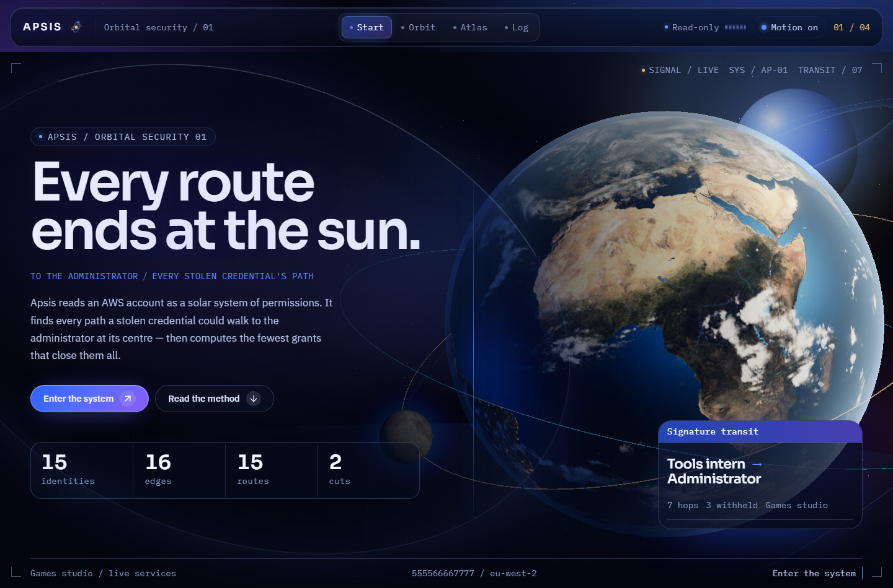
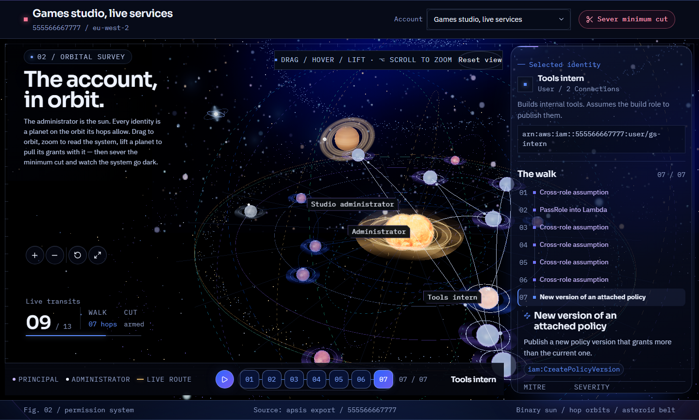

# Apsis

**Every route reaches its apsis.**

Apsis reads an AWS account as a permission system, finds every route from a
low-privilege principal to administrator, and computes the smallest set of grants
to revoke so that no route remains. Apsis turns that output into an orbital
survey you can inspect, step, and sever.

[](https://github.com/Meruyert5/apsis/actions/workflows/ci.yml)
[](https://github.com/Meruyert5/apsis/actions/workflows/pages.yml)
[](LICENSE)
[](pyproject.toml)
[](console/package.json)
[](docs/RESEARCH.md)



## What this is

A policy linter reads one statement and asks whether it is reasonable. Apsis
asks a different question: **what do all those statements add up to?**

- **Routes, not findings.** Every path is a chain of IAM actions, and every step
  keeps the statement that allowed it.
- **Minimum cut.** A max-flow pass identifies the exact edges to remove; a
  second pass groups them into IAM actions a human can approve.
- **Recorded evidence.** The console is a static export. The commands you see are
  the engine's recorded output for the included fixtures.
- **Read-only by construction.** The engine has no AWS client and no network
  code. It parses an export and prints a report.

> The included fleet is synthetic. No customer data, credentials, or live
> account exports are in this repository.

## Live demo

GitHub Pages hosts the console from this repository. After the Pages workflow
runs, the site is at:

**https://meruyert5.github.io/apsis/**

The build uses relative paths, so it also works from a project subpath or a
custom domain. See [docs/DEPLOYMENT.md](docs/DEPLOYMENT.md).

## Why routes

The unit of risk is not a single policy; it is a reachable authority. A principal
with `iam:PassRole` and `lambda:CreateFunction` is not obviously dangerous until
you see that it can hand a role to a function and invoke it. Apsis composes
those steps into edges and searches for the shortest walk to an administrator.

The orbital console is an explanatory layer over that graph:

- the administrator is the sun;
- each principal is a body on the orbit its hop count allows;
- the bright spine is the selected route;
- severing the cut puts the system out.

The atlas is a second view of the same export: 18 escalation primitives against
the 16 fixture accounts. A body's class encodes the observed grant count; its
tone encodes the category. Exact counts stay in the accessible name, the title,
and the inspector.

## How it works

1. **Ingest.** A scenario is JSON: identities, policies, trust, and resources that
   carry a role. It has the same shape a live account export produces.
2. **Compose.** The 18 escalation primitives run against the account. Each one
   answers one question, and each edge records the permission that created it.
3. **Find routes.** A bounded depth-first search enumerates short simple paths
   from each identity to the nearest administrator.
4. **Sever.** Dinic max-flow gives the exact minimum edge cut; a greedy pass maps
   it to revocable IAM actions.
5. **Render.** Terminal, Markdown, SARIF, Mermaid, and the JSON bundle the site
   reads. `apsis export` generates the bundle; the site does not invent data.

## Repository map

```text
apsis/             engine: model, policy matcher, techniques, paths, cut, diff, renderers, cli
scenarios/            sixteen account fixtures
scripts/              export_commands.py, records CLI output for the console
tests/                engine tests, standard library only
console/             Apsis: React site, generated data, verify, audit and capture tooling
docs/                 design, research, assumptions, deployment, screenshots
```

## Quick start

### Engine

Requirements: Python 3.9+ and no third-party packages.

```bash
git clone https://github.com/Meruyert5/apsis.git
cd apsis
python -m apsis scan --scenario startup
python -m apsis sever --scenario startup
python -m apsis check --scenario ci-cd
python -m unittest discover -s tests
```

Useful outputs:

```bash
python -m apsis scan -s enterprise \
  --markdown report.md --sarif apsis.sarif --mermaid graph.mmd
```

| Command | Purpose |
| --- | --- |
| `apsis scan -s <fixture>` | Survey an account and print the routes |
| `apsis sever -s <fixture>` | Compute the minimum cut and the revocations |
| `apsis diff --before <fixture> --after <fixture>` | Compare two snapshots, route aware |
| `apsis check -s <fixture> --sarif out.sarif` | CI gate; exits 1 when a route remains |
| `apsis export -s <fixture> -o bundle.json` | Write the JSON bundle for the console |
| `apsis techniques` | List the 18 modelled techniques |

### Console

Requirements: Node 20+.

```bash
cd console
npm ci
npm run dev
```

The local site is served by Vite. To regenerate its data from the engine:

```bash
python -m apsis export --all -o console/src/data
python scripts/export_commands.py console/src/data/commands.json
cd console && npm run build
```

### Checks

```bash
cd console
npm run build
npm run verify     # flows, responsive layout, motion parity
npm run audit      # contrast, headings, names, target size
```

`verify` and `audit` drive a local Chrome over the DevTools protocol; set
`CHROME_PATH` if Chrome is not in the default Windows location.

## The console

| Section | What it does |
| --- | --- |
| Start | Lit Earth, the signature transit, and the five-move method |
| Orbit | The account as a solar system: drag, pan, zoom, lift a body, step a route, sever the cut |
| Atlas | 18 techniques × 16 accounts, with the fix in the inspector |
| Log | A command builder beside the engine's recorded output |
| Resolution | The account at zero, the export facts, and the notes |



The design is a deep-space cybernetic console rather than a dashboard: one fixed
blue-violet field behind everything, glass plates with a restrained rose edge, a
top command rail, and a dark terminal for recorded output. Gold appears only as a
live signal. The full system is in [docs/DESIGN.md](docs/DESIGN.md).

## Data and scope

**This is a demonstration fleet, not a benchmark.** The 16 fixtures contain 194
identities, 163 escalation edges, and 144 routes. They are deliberately small
enough to read and varied enough to exercise composition, depth, trust rewriting,
and clean-account cases. They are synthetic.

| Fixture | Account | What it exercises |
| --- | --- | --- |
| `startup` | Series A SaaS | Short, dense routes through a CI role |
| `enterprise` | Enterprise, inherited | Deep role chains across inherited policies |
| `fintech` | Fintech ledger | Regulated data paths and a break-glass user |
| `healthcare` | Health network | Claims pipeline with a writable policy step |
| `games-studio` | Games studio, live services | Player data, multiple resources, live ops |
| `gov-contractor` | Federal contractor | Benefits portal, vendor shell, batch host |
| `ml-platform` | ML platform | Outsourced labelling role and model access |
| `legacy` | Legacy account | A small account with almost no guardrails |
| `multi-account` | Multi-account platform | Cross-trust vendor audit and break-glass |
| `ci-cd` | Delivery pipeline, before | Pipeline role before a hardening PR |
| `ci-cd-after` | Delivery pipeline, after | The same account after the cut |
| `retail` | Retail marketplace | Merged platforms with an onboarding leftover |
| `media` | Media network | Release pipeline that can publish policy |
| `research` | Research lab | Grant-funded warehouse write path |
| `logistics` | Logistics network | 24/7 ops with vendor and break-glass roles |
| `platform` | Platform group | Regulated workloads and a self-rewriting role |

The console models **18 escalation primitives**. Public IAM research documents
more (Rhino Security Labs lists 21; PMapper's rule set is broader). The 18 are a
curated, tested subset. A clean result means "no route in the modelled graph",
not "no possible escalation in AWS".

The engine does not evaluate every IAM condition, service control policy, or
resource policy. The full boundary list is in
[docs/ASSUMPTIONS.md](docs/ASSUMPTIONS.md); the comparison with PMapper,
Cloudsplaining, Pacu and IAM-Deescalate is in [docs/RESEARCH.md](docs/RESEARCH.md).

To use it against a real account: export the account's authorization details,
convert them to a scenario, and run the engine with no credentials. Do not commit
the export; `.gitignore` excludes authorization dumps.

## Security

- Read-only: the engine has no AWS client, no shell execution, and no network.
- The site is static: no analytics, no cookies, no third-party scripts, no runtime
  data fetching.
- The build injects a restrictive CSP; `script-src 'self'` and `connect-src
  'self'` are part of it.
- Fixtures and exported bundles are synthetic; the repository contains no
  credentials, secrets, or customer data.
- Dependency and static-analysis workflows are in `.github/workflows`.

Report a vulnerability through a private GitHub security advisory. See
[SECURITY.md](SECURITY.md).

## Deployment

The included `.github/workflows/pages.yml` builds `console` and deploys
`console/dist` to GitHub Pages on pushes to `main`. Enable **Settings → Pages →
Source: GitHub Actions**. The site uses relative assets and needs no environment
variables.

Details, custom domains, and the CLI steps are in
[docs/DEPLOYMENT.md](docs/DEPLOYMENT.md).

## Roadmap

| Now | Next | Later |
| --- | --- | --- |
| 18 primitives, 16 fixtures, route survey, minimum cut, static console, Pages workflow | Live import from `GetAccountAuthorizationDetails`; condition and resource-policy evaluation; CSV/table view for the atlas | Benchmark against PMapper; drift view in the console; more primitives with fixture coverage |

## Contributing

Read [CONTRIBUTING.md](CONTRIBUTING.md). Keep new behaviour test-first, keep
fixtures synthetic, never commit an authorization export, and run `npm run
verify` / `npm run audit` before a UI change.

## Credits

Planet textures by [Solar System Scope](https://www.solarsystemscope.com/textures/)
under CC BY 4.0. Earth and lunar maps are NASA-derived. Sora and IBM Plex are
licensed under the SIL Open Font License. Three.js, React, Vite and Lucide retain
their upstream licences. The full attribution is in [NOTICE.md](NOTICE.md).

## License

The engine and functional source code are released under the [MIT License](LICENSE).
The **Apsis name, wordmark, visual design, and screenshots are © 2026 Meruyert
Oshayeva; all rights reserved.** The MIT grant does not grant permission to
reproduce the distinctive visual identity as a product. Third-party assets keep
their own licences. See [NOTICE.md](NOTICE.md).

## Author

Designed and built by **Meruyert Oshayeva**.

This is an independent security research project. It is not affiliated with,
endorsed by, or sponsored by Amazon Web Services.
