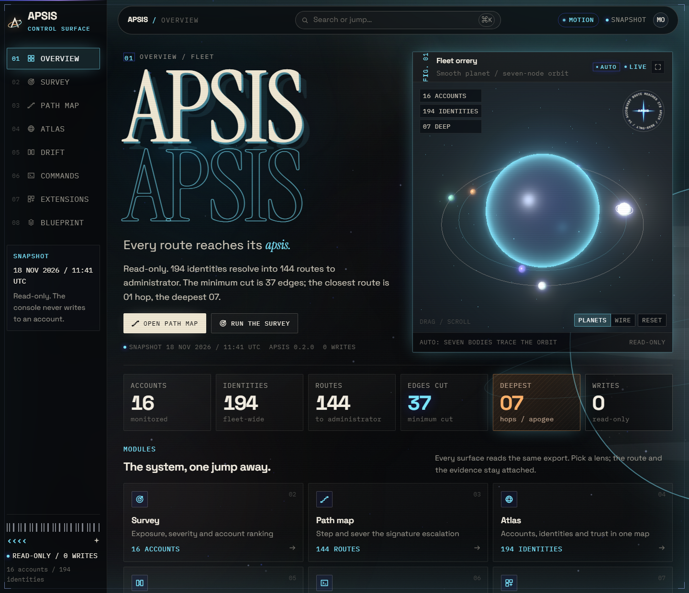
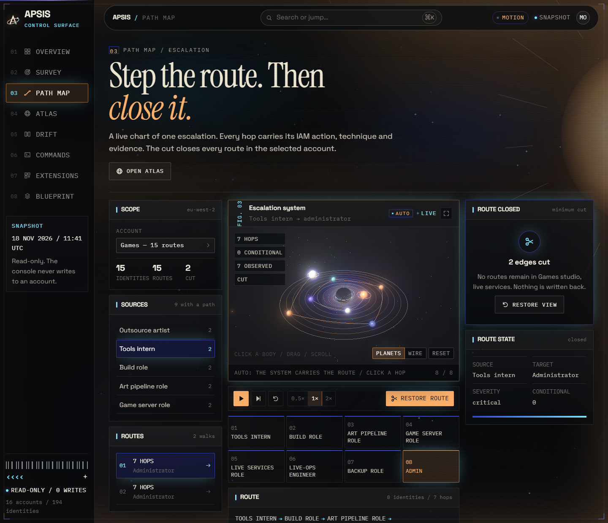
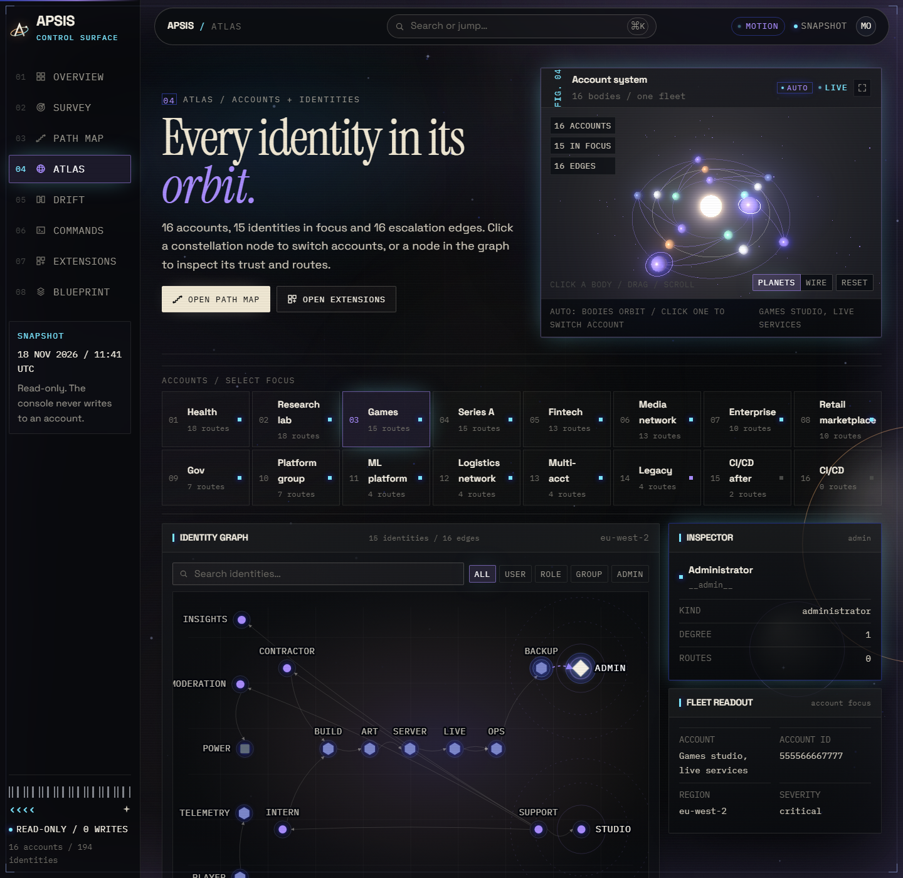
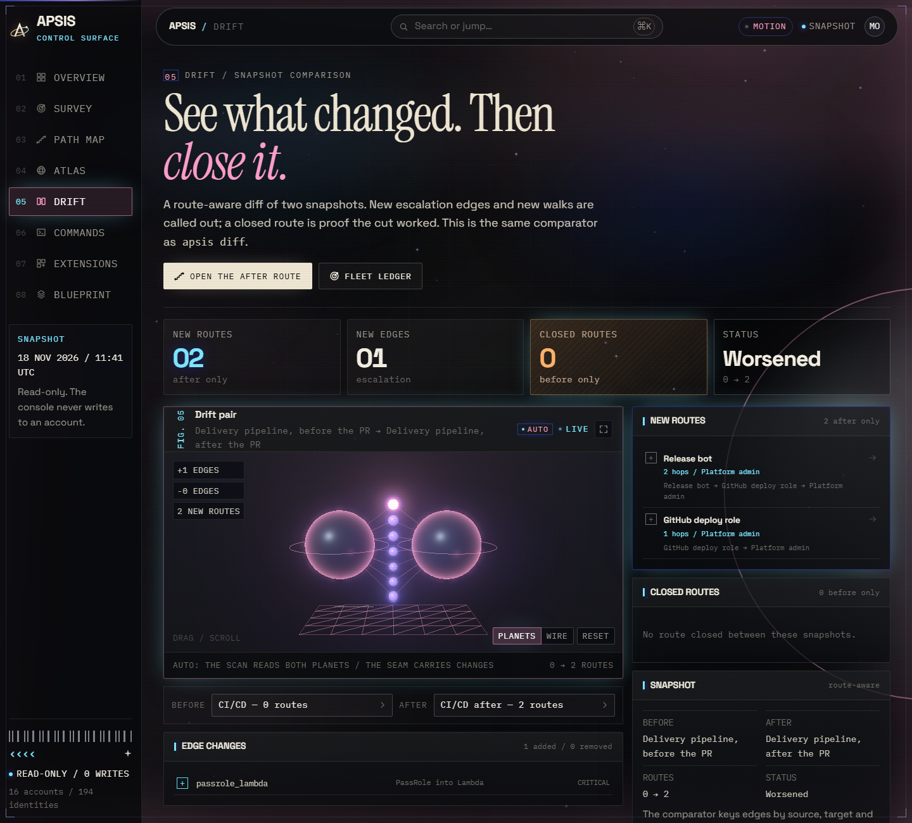
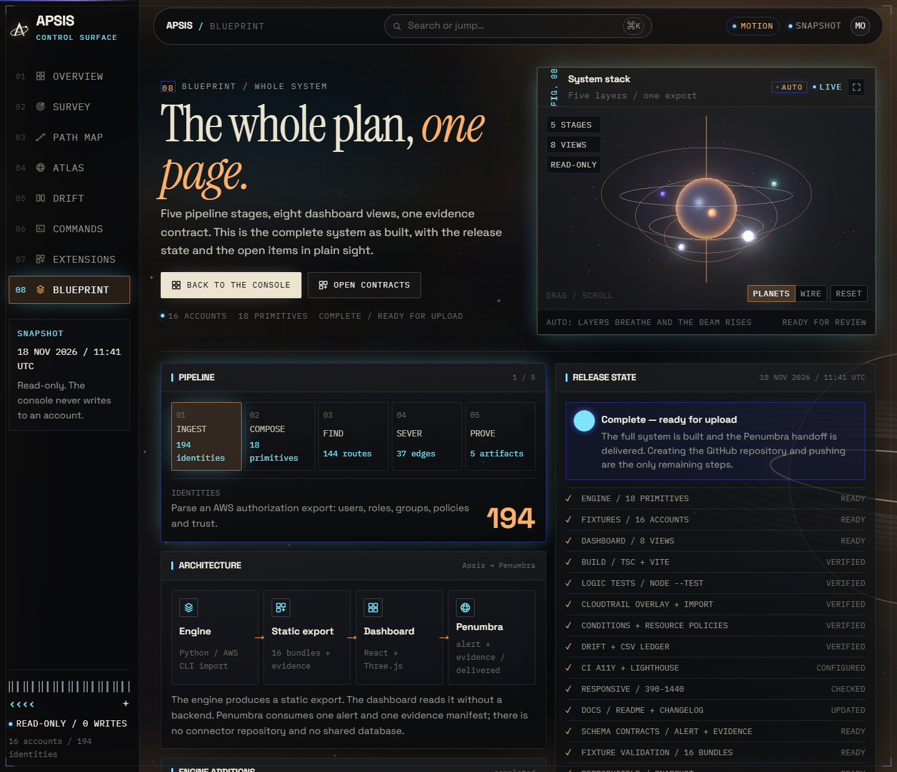
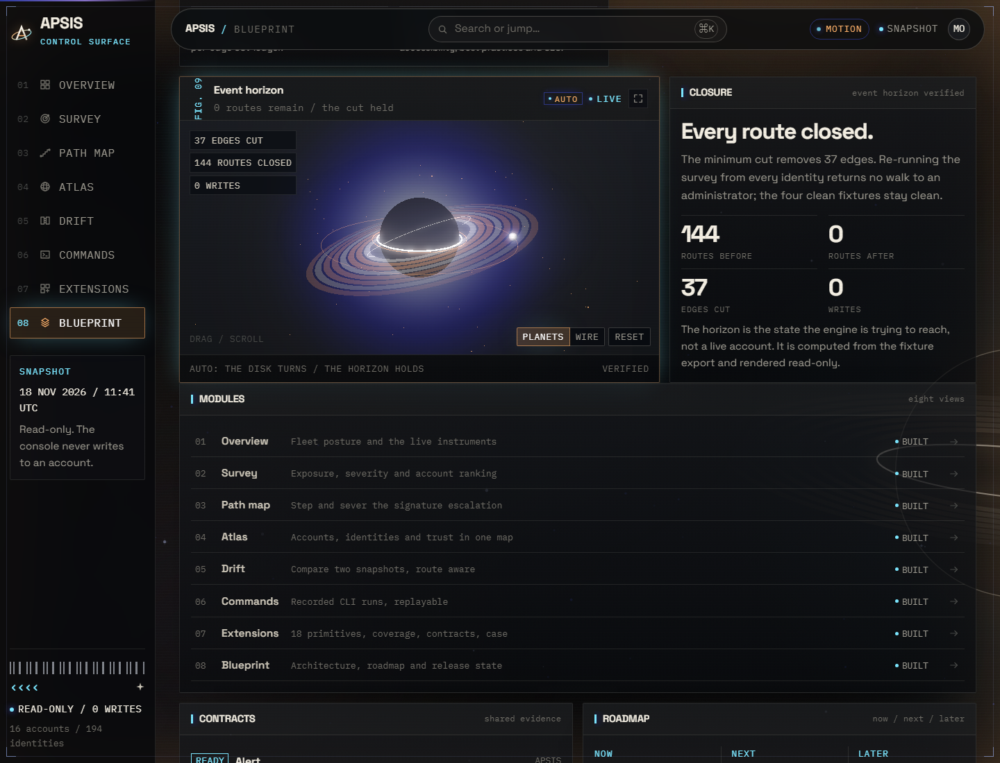

# Apsis

**Every route reaches its apsis.**

Apsis reads an AWS account as a permission system, finds every route from a
low-privilege principal to administrator, and computes the smallest set of grants
to revoke so that no route remains. Apsis turns that output into an orbital
console you can inspect, step, and sever.

[](https://github.com/Meruyert5/apsis/actions/workflows/ci.yml)
[](https://github.com/Meruyert5/apsis/actions/workflows/pages.yml)
[](LICENSE)
[](pyproject.toml)
[](console/package.json)
[](docs/RESEARCH.md)



## Reviewer path

1. **Overview** — read the six fleet figures and the orbit. Every number is a
   fixture total: 16 accounts, 194 identities, 144 routes, 37 cut edges, 07 deep,
   0 writes.
2. **Survey** — rank the accounts, replay the scan, then download the route
   ledger as CSV.
3. **Path map** — press play, watch the hops advance, then **Apply cut**. The
   route closes and the star collapses into a black hole.
4. **Atlas** — switch account from the list, click a node in the 3D
   constellation, then inspect its trust and routes in the graph.
5. **Drift** — compare the CI/CD baseline with the after snapshot; two new routes
   and one new edge are called out.
6. **Extensions** — open the 288-cell coverage field, the alert/evidence
   contracts and the observed-path case.
7. **Blueprint** — read the pipeline, architecture, roadmap and the release
   state, then the event-horizon plate. The only open items are approval and the
   GitHub push.

The full architecture and interaction inventory are in
[docs/DASHBOARD.md](docs/DASHBOARD.md). The release gate is
[docs/RELEASE.md](docs/RELEASE.md).

## What this is

A policy linter reads one statement and asks whether it is reasonable. Apsis
asks a different question: **what do all those statements add up to?**

- **Routes, not findings.** Every path is a chain of IAM actions, and every step
  keeps the statement that allowed it.
- **Minimum cut.** A max-flow pass identifies the exact edges to remove; a
  second pass groups them into IAM actions a human can approve.
- **Recorded evidence.** The console is a static export. The commands you see are
  the engine's recorded output for the included fixtures.
- **Read-only by construction.** The engine has no AWS SDK and never writes. It
  parses an export and prints a report. The optional import shells out to the
  AWS CLI for a read-only IAM dump.

> The included fleet is synthetic. No customer data, credentials, or live
> account exports are in this repository.

## Live demo

GitHub Pages hosts the console from this repository. After the Pages workflow
runs, the site is at:

**https://meruyert5.github.io/apsis/**

The build uses relative paths, so it also works from a project subpath or a
custom domain. See [docs/DEPLOYMENT.md](docs/DEPLOYMENT.md).

The dashboard is served at `/`. The architecture and interaction inventory are
in [docs/DASHBOARD.md](docs/DASHBOARD.md).

## Why routes

The unit of risk is not a single policy; it is a reachable authority. A principal
with `iam:PassRole` and `lambda:CreateFunction` is not obviously dangerous until
you see that it can hand a role to a function and invoke it. Apsis composes
those steps into edges and searches for the shortest walk to an administrator.

The dashboard is an explanatory layer over that graph:

- the **Overview orb** carries the fleet totals, the seven-hop orbit and the live
  evidence feed;
- the **Path map** threads one route through the account constellation, with a
  gate for each hop and a cut that fractures the ascent;
- the **Atlas** turns the same identities into a directed trust graph you can
  click and inspect;
- applying the cut closes the route and the guardrails keep it closed.

The **Extensions coverage field** is a second view of the same export: 18
primitives by 16 accounts. A lit cell is an edge in that account; exact counts
stay in the tooltip and the ledger.

## How it works

1. **Ingest.** A scenario is JSON: identities, policies, trust, and resources that
   carry a role. It has the same shape a live account export produces.
2. **Compose.** The 18 escalation primitives run against the account. Each one
   answers one question, and each edge records the permission that created it.
3. **Find routes.** A bounded depth-first search enumerates short simple paths
   from each identity to the nearest administrator.
4. **Sever.** Dinic max-flow gives the exact minimum edge cut; a greedy pass maps
   it to revocable IAM actions.
5. **Render.** Terminal, Markdown, SARIF, Mermaid, and the JSON bundle the site
   reads. `apsis export` generates the bundle; the site does not invent data.

## Repository map

```text
apsis/                engine: model, policy matcher, techniques, paths, cut, diff, renderers, cli
scenarios/            sixteen account fixtures
schema/               penumbra.alert/v1 and penumbra.evidence/v1 contracts
cases/                observed-path case, validated alert, evidence, guardrails
scripts/              export_commands.py, records CLI output for the console
tests/                engine tests and contract tests, standard library only
console/              React site: eight-view dashboard, generated data, audit tooling
docs/                 design, research, assumptions, deployment, release, screenshots
```

## Quick start

### Engine

Requirements: Python 3.9+ and no third-party packages.

```bash
git clone https://github.com/Meruyert5/apsis.git
cd apsis
python -m apsis scan --scenario startup
python -m apsis sever --scenario startup
python -m apsis check --scenario ci-cd
python -m unittest discover -s tests
```

Useful outputs:

```bash
python -m apsis scan -s enterprise \
  --markdown report.md --sarif apsis.sarif --mermaid graph.mmd
```

| Command | Purpose |
| --- | --- |
| `apsis scan -s <fixture>` | Survey an account and print the routes |
| `apsis sever -s <fixture>` | Compute the minimum cut and the revocations |
| `apsis diff --before <fixture> --after <fixture>` | Compare two snapshots, route aware |
| `apsis check -s <fixture> --sarif out.sarif` | CI gate; exits 1 when a route remains |
| `apsis overlay -s <fixture> --cloudtrail events.json` | Mark observed edges and routes from CloudTrail |
| `apsis ledger -s <fixture> -o ledger.csv` | One CSV row per route edge |
| `apsis import --from-aws -o account.json` | Convert a live IAM authorization dump |
| `apsis import --input dump.json -o account.json` | Convert a saved dump |
| `apsis export -s <fixture> -o bundle.json` | Write the JSON bundle for the console |
| `apsis techniques` | List the 18 modelled techniques |

`scan` and `export` also accept `--cloudtrail` to carry observation fields into
the bundle. The site job in CI runs the accessibility audit across all eight
views and Lighthouse with accessibility, best-practice and SEO assertions.


### Console

Requirements: Node 20+.

```bash
cd console
npm ci
npm run dev
```

The local site is served by Vite. To regenerate its data from the engine:

```bash
python -m apsis export --all -o console/src/data
python scripts/export_commands.py console/src/data/commands.json
cd console && npm run build
```

### Checks

```bash
cd console
npm run build
npm run test:logic  # graph, depth and route-placement tests
npm run audit       # contrast, headings, names, target size
```

`audit` drives a local Chrome over the DevTools protocol; set
`CHROME_PATH` if Chrome is not in the default Windows location.

## Dashboard

`/` is the dashboard: eight views over the same static export, each with a
glossy planet scene and a wireframe instrument. One Vite entry, one shell, no
legacy console. Every figure carries a `Planets` / `Wire` switch. The register is
an observatory ledger: warm black and bone, Instrument Serif display, Space
Grotesk reading, IBM Plex Mono telemetry, one accent per view and a cropped
celestial body at the page edge.

- **Overview** - orrery; fleet figures, module map, fleet pulse, evidence.
- **Survey** - ringed orbit; severity, ranking, coverage, searchable ledger.
- **Path map** - solar system; autoplay, step, speed, cut/restore, clickable
  bodies, hop detail, route ledger. The cut turns the star into a black hole.
- **Atlas** - account system; star, 16 account bodies, trust arcs, plus a
  full-width identity-graph workbench with a 16-account strip, search, kind
  filters, depth rings and an inspector.
- **Drift** - planet pair; route-aware diff, new and closed routes, edge
  changes, the same comparator as `apsis diff`.
- **Commands** - command core; 114 recorded runs, typewriter output, replay, copy.
- **Extensions** - ringed system; 18 primitives, 288-cell coverage matrix, six
  contracts including the handoff, alert sample and the observed-path case.
- **Blueprint** - orbital planes plus the event-horizon plate; pipeline,
  architecture, modules, roadmap, verification and release state.

Global: `Cmd/Ctrl+K` command palette, motion toggle, fullscreen on every figure,
a `Planets` / `Wire` switch on every instrument, sharp 2px panel geometry,
floating glass topbar, warm-black field with a view accent, Instrument Serif
display type, a cropped planet or black hole at the page edge, 64px HUD grid,
fine grain, CRT scanlines, ambient edge glow, hero aura, moving constellation
background, bloom-lit glass panels, neon focus states, automatic 2D fallback
when WebGL is unavailable, clickable bodies on Path map, Atlas, Drift and
Extensions, and the same read-only export. The architecture and interaction
inventory are in [docs/DASHBOARD.md](docs/DASHBOARD.md).

### Dashboard screenshots












The dashboard replaces every earlier console and design-lab iteration.

## Data and scope

**This is a demonstration fleet, not a benchmark.** The 16 fixtures contain 194
identities, 163 escalation edges, and 144 routes. They are deliberately small
enough to read and varied enough to exercise composition, depth, trust rewriting,
and clean-account cases. They are synthetic.

| Fixture | Account | What it exercises |
| --- | --- | --- |
| `startup` | Series A SaaS | Short, dense routes through a CI role |
| `enterprise` | Enterprise, inherited | Deep role chains across inherited policies |
| `fintech` | Fintech ledger | Regulated data paths and a break-glass user |
| `healthcare` | Health network | Claims pipeline with a writable policy step |
| `games-studio` | Games studio, live services | Player data, multiple resources, live ops |
| `gov-contractor` | Federal contractor | Benefits portal, vendor shell, batch host |
| `ml-platform` | ML platform | Outsourced labelling role and model access |
| `legacy` | Legacy account | A small account with almost no guardrails |
| `multi-account` | Multi-account platform | Cross-trust vendor audit and break-glass |
| `ci-cd` | Delivery pipeline, before | Pipeline role before a hardening PR |
| `ci-cd-after` | Delivery pipeline, after | The same account after the cut |
| `retail` | Retail marketplace | Merged platforms with an onboarding leftover |
| `media` | Media network | Release pipeline that can publish policy |
| `research` | Research lab | Grant-funded warehouse write path |
| `logistics` | Logistics network | 24/7 ops with vendor and break-glass roles |
| `platform` | Platform group | Regulated workloads and a self-rewriting role |

The console models **18 escalation primitives**. Public IAM research documents
more (Rhino Security Labs lists 21; PMapper's rule set is broader). The 18 are a
curated, tested subset. A clean result means "no route in the modelled graph",
not "no possible escalation in AWS".

The engine does not evaluate every IAM condition, service control policy, or
resource policy. The full boundary list is in
[docs/ASSUMPTIONS.md](docs/ASSUMPTIONS.md); the comparison with PMapper,
Cloudsplaining, Pacu and IAM-Deescalate is in [docs/RESEARCH.md](docs/RESEARCH.md).

To use it against a real account: export the account's authorization details,
convert them to a scenario, and run the engine with no credentials. Do not commit
the export; `.gitignore` excludes authorization dumps.

## Security

- Read-only: the engine has no AWS SDK and never calls a mutating API. The only
  shell call is the optional, read-only `aws iam get-account-authorization-details`
  import.
- The site is static: no analytics, no cookies, no third-party scripts, no runtime
  data fetching.
- The build injects a restrictive CSP; `script-src 'self'` and `connect-src
  'self'` are part of it.
- Fixtures and exported bundles are synthetic; the repository contains no
  credentials, secrets, or customer data.
- Dependency and static-analysis workflows are in `.github/workflows`.

Report a vulnerability through a private GitHub security advisory. See
[SECURITY.md](SECURITY.md).

## Deployment

The included `.github/workflows/pages.yml` builds `console` and deploys
`console/dist` to GitHub Pages on pushes to `main`. Enable **Settings → Pages →
Source: GitHub Actions**. The site uses relative assets and needs no environment
variables.

Details, custom domains, and the CLI steps are in
[docs/DEPLOYMENT.md](docs/DEPLOYMENT.md).

## Roadmap

| Now | Next | Later |
| --- | --- | --- |
| 18 primitives, 16 fixtures, route survey, minimum cut; eight-view dashboard with CloudTrail overlay, live IAM import, condition/resource-policy evaluation, drift and CSV ledger; Penumbra handoff, CI gate and Pages workflow | Benchmark against PMapper; expand condition and import coverage; a performance budget for the 3D instruments | Network threat-hunting lab; more primitives with fixture coverage |

Everything in the static/demo scope is delivered. The next work is engine depth:
condition coverage against real requests, a PMapper benchmark, and a performance
budget for the eight WebGL instruments.

- **[docs/RELEASE.md](docs/RELEASE.md)** - preflight, GitHub Pages setup, upload
  gate and post-deploy checks.

## Contributing

Read [CONTRIBUTING.md](CONTRIBUTING.md). Keep new behaviour test-first, keep
fixtures synthetic, never commit an authorization export, and run `npm run
test:logic` / `npm run audit` before a UI change.

## Credits

Instrument Serif, Space Grotesk and IBM Plex Mono are licensed under the SIL
Open Font License. Three.js, React and Vite retain their upstream licences. The
full attribution is in [NOTICE.md](NOTICE.md).

## License

The engine and functional source code are released under the [MIT License](LICENSE).
The **Apsis name, wordmark, visual design, and screenshots are © 2026 Meruyert
Oshayeva; all rights reserved.** The MIT grant does not grant permission to
reproduce the distinctive visual identity as a product. Third-party assets keep
their own licences. See [NOTICE.md](NOTICE.md).

## Author

Designed and built by **Meruyert Oshayeva**.

This is an independent security research project. It is not affiliated with,
endorsed by, or sponsored by Amazon Web Services.
